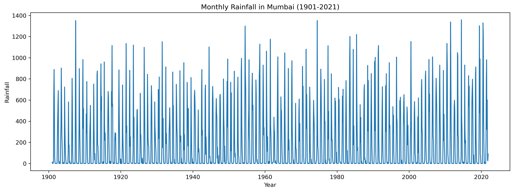
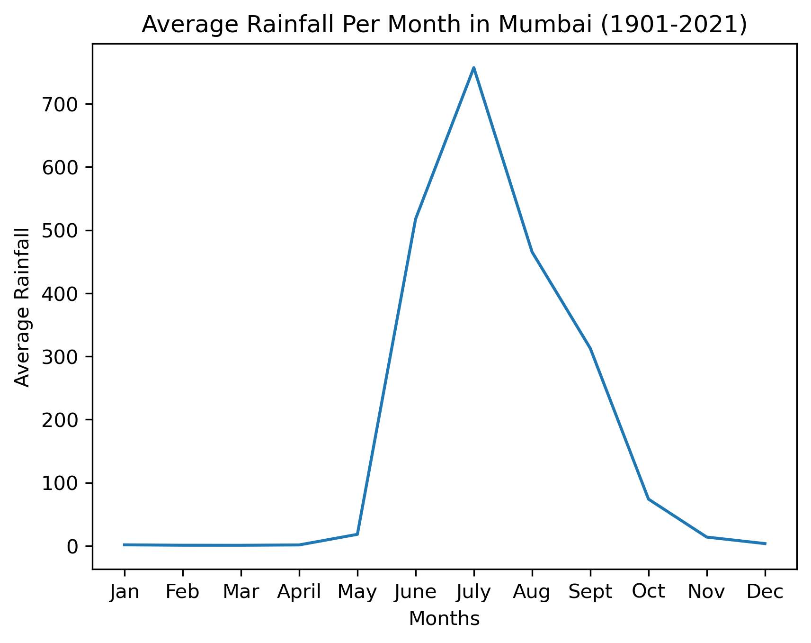
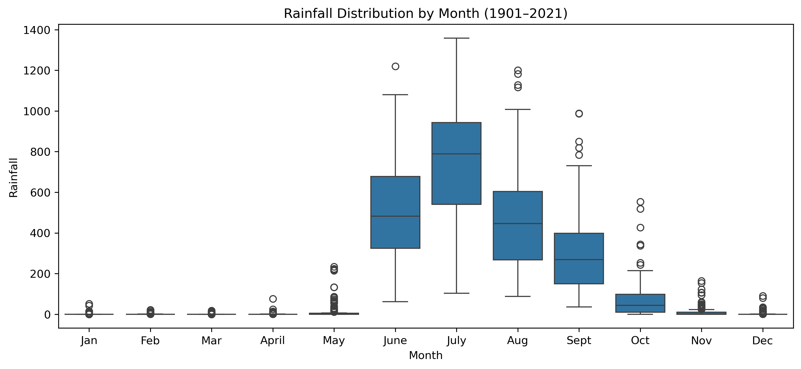
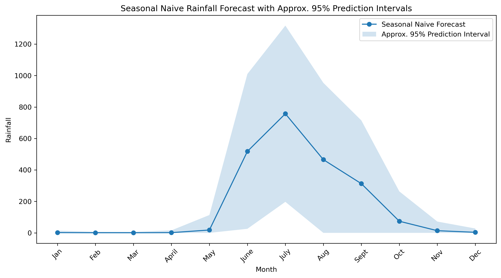

# Mumbai Rainfall Forecasting

Monthly rainfall forecasting for Mumbai using 121 years of historical data (1901–2021). The project builds a full time-series workflow, then tests whether machine learning can beat a simple seasonal baseline. **It cannot: the seasonal-naive monthly average wins**, so that is the final model.

## Key result

| Model | MAE ↓ | RMSE ↓ | R² ↑ |
|---|---:|---:|---:|
| Linear Regression | 123.73 | 201.11 | 0.617 |
| XGBoost | 95.67 | 179.31 | 0.695 |
| Random Forest (lag + rolling features) | 95.33 | 178.52 | 0.698 |
| Random Forest (tuned) | 94.26 | 176.84 | 0.704 |
| Random Forest + `Month_avg` feature | 91.54 | 172.94 | 0.717 |
| Random Forest (`Month_avg` only) | 82.63 | 162.68 | 0.749 |
| **Seasonal-naive (monthly average)** | **82.60** | **162.59** | **0.749** |

*Held-out test set: Jan 1998 – Dec 2021 (24 years). Rainfall in mm.*

**Takeaway:** almost all predictable signal in this series is calendar seasonality. Lag and rolling-window features, and hyperparameter tuning, did not improve on a model that simply predicts each month's historical average. A Random Forest given only that average matches the baseline almost exactly, so the simpler method is preferred.

## What the project does

1. **Data prep:** reshaped the wide table (one row per year, one column per month) into a monthly time series with a datetime index.
2. **EDA:** strong seasonality (July is the wettest month at about 757 mm average, then June 518, August 466, September 313), much higher variability in monsoon months, and a lag-12 autocorrelation of 0.75.
3. **Feature engineering:** lag features (1 and 12 months) and rolling means (windows of 2, 3, 6, 12), all built from past values only.
4. **Validation:** chronological 80/20 split (train 1902–1997, test 1998–2021) and 5-fold `TimeSeriesSplit` cross-validation, with no shuffling.
5. **Models:** Linear Regression, Random Forest, XGBoost; Random Forest tuned with `GridSearchCV`.
6. **Baseline benchmarking:** compared everything against a seasonal-naive forecast, then ran controlled experiments (adding `Month_avg`, using it alone).
7. **Final forecast:** the monthly historical average, with approximate 95% prediction intervals taken from each month's historical spread.

## Figures

| | |
|---|---|
|  |  |
|  |  |

## Limitations

- The final forecast is **climatological**: it gives the expected rainfall for a calendar month, not a prediction for a specific future year.
- It uses rainfall history only. Year-to-year swings are likely driven by factors not in the data (for example ENSO and the Indian Ocean Dipole).
- The prediction intervals use mean ± 1.96 standard deviations, which assumes roughly normal errors. Monthly rainfall is skewed, so lower bounds are clipped at zero and the intervals are approximate.
- Cross-validation of the Random Forest was run on the training period only, while the seasonal-naive cross-validation used the full series, so the cross-validation figures are not strictly comparable. The **held-out test table above uses the same test period for every model** and is the fair comparison.
- No real future observations exist yet to check the forecast against.

## Future work

- Add exogenous climate indices (ENSO, IOD) and meteorological variables.
- Try models built for time series (SARIMA, Prophet) and quantile-based or conformal prediction intervals.
- Retest the forecast as new rainfall observations become available.

## Project structure

```
mumbai-rainfall-forecasting/
├── rainfall_forecasting.ipynb   # full analysis
├── mumbai-monthly-rains.csv     # dataset (annual rows, monthly columns)
├── graphs/                      # figures saved by the notebook
├── requirements.txt
└── README.md
```

## How to run

```bash
git clone https://github.com/UmarIntakhab/mumbai-rainfall-forecasting.git
cd mumbai-rainfall-forecasting
pip install -r requirements.txt
jupyter notebook rainfall_forecasting.ipynb
```

Run all cells from top to bottom. The notebook reads `mumbai-monthly-rains.csv` from the same folder and saves figures to `graphs/`.

## Tech stack

Python · Pandas · NumPy · Scikit-learn · XGBoost · Matplotlib · Seaborn

## Author

**Umar Intakhab**: BCA graduate, Jamia Hamdard University. Built as part of on-the-job training at Spinnaker Analytics.
Contact: umarintakhab1976@gmail.com
